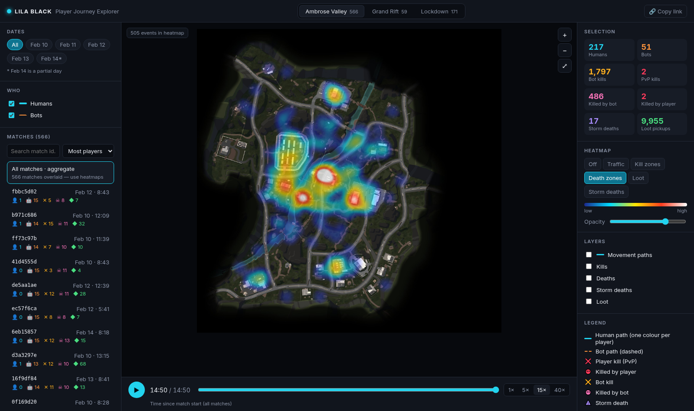

# LILA BLACK · Player Journey Explorer

A browser tool for Level Designers to see how players actually move, fight, loot and die on LILA BLACK's three maps, built from 5 days of production telemetry (Feb 10–14, 2026; 89,104 events, 796 matches, 339 players).

**Live demo:** `<DEPLOYED_URL>` (see [Deploy](#deploy))



## What it does

| Need | How it works in the tool |
|---|---|
| Journeys on the correct minimap | Every event is converted from world `(x, z)` to minimap pixels using the README formula, verified against the README example (see `ARCHITECTURE.md`). |
| Humans vs bots | Humans use solid lines (one colour per player). Bots use dashed orange lines. You can toggle either group. |
| Event markers | ✕ kills (red for PvP, amber for bot kills), skull dots for deaths (red for killed by a player, pink for killed by a bot), triangles for storm deaths, green diamonds for loot. Hover a marker for details. In aggregate view, click a marker to open its match. |
| Filters | Map tabs, date chips (multi-select), and a searchable, sortable match list (most players, most combat, most loot, longest). |
| Timeline / playback | Play, pause or scrub a single match (Space toggles play), with 1×–40× speed. Ticks on the track mark each kill and death. Player heads disappear when that player dies. In aggregate mode the slider shows everything up to N seconds into a match, across all matches. |
| Heatmaps | Traffic, kill zones, death zones, loot and storm deaths, with an opacity control. They follow every filter, including the timeline. |
| Shareable links | Map, match, dates, heatmap and timeline position are kept in the URL hash. Use **Copy link** to send someone the exact view. |

Interactions: scroll to zoom, drag to pan, double-click (or ⤢) to reset. Selecting a match zooms to where it happened.

## Tech stack

- **Vite + React 18 + TypeScript.** The app is static and has no backend.
- **HTML Canvas 2D** for the map, paths, markers and heatmap (a custom binned grid with a box-blur kernel; no chart library).
- **Python (pyarrow + pandas + Pillow)** for one offline preprocessing step that turns parquet files into compact JSON.

## Run locally

Requirements: Node 18+ (tested on Node 24). Python 3.10+ is only needed if you want to regenerate the data.

```bash
npm install
npm run dev        # http://localhost:5173
# or a production build
npm run build && npm run preview   # http://localhost:4173
```

The processed data (`public/data/*.json`, about 2.3 MB raw / 0.5 MB gzipped) and the web-sized minimaps (`public/minimaps/*.jpg`) are committed, so you don't need the raw parquet to run the app.

### Regenerate data from the raw parquet (optional)

```bash
python3 -m venv .venv && . .venv/bin/activate
pip install pyarrow pandas pillow
python scripts/preprocess.py --src /path/to/player_data   # folder holding February_* and minimaps/
```

The script checks the coordinate conversion against the README example before it writes anything.

## Environment variables

| Variable | Used at | Default | Purpose |
|---|---|---|---|
| `BASE_PATH` | build time | `./` locally; `/lila-journey-viz/` on GitHub Actions | Public base path. The Pages workflow sets this to the project-site path. Override it for a domain-root host (`/`) or another sub-path. |

There are no runtime secrets or API keys.

## Deploy

The output is a fully static `dist/` folder.

- **GitHub Pages (preconfigured):** push to `main`. A repository admin must set *Settings → Pages → Source* to **GitHub Actions** once (Actions cannot create the Pages site). `.github/workflows/deploy.yml` then builds with base path `/lila-journey-viz/` and publishes to `https://<user>.github.io/lila-journey-viz/`.
- **Vercel / Netlify:** import the repo. Framework is Vite, build command is `npm run build`, output folder is `dist`.

## Repo layout

```
scripts/preprocess.py   parquet → public/data/*.json + public/minimaps/*.jpg
src/data.ts             types, loaders, event codes, colours, world→pixel helper
src/MapView.tsx         canvas renderer: minimap, heatmap, paths, markers, zoom/pan, hover
src/heatmap.ts          binned + blurred density heatmap
src/App.tsx             filters, match list, timeline/playback, stats, URL state
ARCHITECTURE.md         design + data flow + coordinate mapping
INSIGHTS.md             three findings for Level Designers
```
